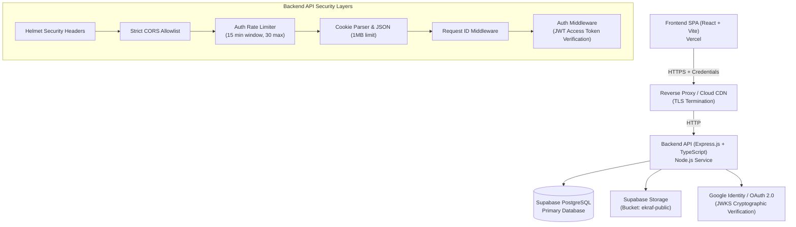

# EKRAF HUB — Arsitektur Fondasi Backend
**Dokumen Referensi:** `docs/architecture/BACKEND_ARCHITECTURE.md`  
**Status:** Stabil & Terdokumentasi  
**Branch:** `fix/backend-foundation-security`

---

## 1. Visi & Target Kapasitas
Ekraf HUB dirancang sebagai platform ekonomi kreatif terpadu untuk Kabupaten Tuban dan berpotensi diekspansi ke wilayah lain di Jawa Timur dan Indonesia. Sistem ditargetkan mampu menangani:
- Ribuan akun kreator dan pelaku usaha kreatif (UMKM / industri kreatif).
- Ribuan portofolio karya (Showcase).
- Ribuan katalog produk kerajinan/kriya/kuliner/fashion (Pasar).
- Interaksi publik (pencarian, eksplorasi kategori subsektor, dan kontak pemesanan langsung melalui WhatsApp resmi kreator).
- Moderasi terpusat oleh tim Administrator.

---

## 2. Diagram Komponen Arsitektur

---

## 3. Komponen Utama & Pola Desain

### 3.1 Web Application & Routing (`apps/api/src/app.ts`)
- **Express.js 4.21+**: HTTP routing terstruktur per domain bisnis (`auth`, `profile`, `categories`, `subapps`, `creatives`, `works`, `products`, `moderation`, `admin`, `uploads`).
- **Middleware Rantai Pengamanan**:
  1. `helmet()`: Security headers standar (X-Content-Type-Options, X-Frame-Options, HSTS).
  2. `cors()`: Membatasi origin hanya pada `WEB_ORIGIN` resmi (wildcard dilarang keras saat credentials aktif).
  3. `rateLimit()`: Menangkal serangan brute force pada endpoint autentikasi (`/login`, `/register`, `/google`).
  4. `requestIdMiddleware`: Melacak alur penanganan setiap request dengan UUID unik (`x-request-id`).
  5. `authenticate`: Verifikasi stateless access token dari cookie HttpOnly atau header `Authorization: Bearer <token>`.
  6. `errorHandler`: Error handling terpusat yang memformat respons seragam dan menyembunyikan stack trace sensitif di mode production.

### 3.2 Lapisan Data & ORM (`apps/api/src/db.ts`)
- **Prisma ORM**: Menyediakan type-safe data access client.
- **Dual Datasource Strategy**:
  - `schema.postgresql.prisma`: Menjadi acuan target production di Supabase PostgreSQL dengan native enum (`Role`, `ContentStatus`, `CategoryKind`, `ProductAvailability`) dan relasi foreign key lengkap.
  - `schema.prisma`: Kompatibel untuk pengujian lokal offline (SQLite).
- **Integritas Transaksi**: Operasi kritis seperti registrasi (User + UserProfile + Session), rotasi token refresh, dan moderasi konten dijalankan dalam `prisma.$transaction`.

### 3.3 Media Storage Service (`apps/api/src/utils/storage.ts`)
- Menggunakan **Supabase Storage** (bucket `ekraf-public`) untuk persistensi aset media cloud.
- Verifikasi keamanan unggahan meliputi:
  - Validasi ukuran file (maksimal 2MB).
  - Validasi MIME deklaratif (`image/jpeg`, `image/png`, `image/webp`).
  - Verifikasi **Cryptographic Magic Bytes (File Signature)** untuk mencegah eksploitasi ekstensi palsu atau web shell tersembunyi.
  - Penamaan file menggunakan UUID acak (`folder/UUID.ext`) untuk mencegah directory traversal dan file collision.
  - Mode fallback lokal otomatis untuk pengujian luring.

---

## 4. Invarian Bisnis Kritis
1. **K-01 (Creator Ownership Guard):** Setiap karya (Showcase) dan produk (Pasar) wajib terikat pada `CreativeProfile` yang ditugaskan kepada `User` terkait melalui relasi tabel `CreativeProfileOwner`. Modifikasi oleh kreator yang tidak berhak akan ditolak dengan HTTP 403.
2. **K-03 (Revision Lifecycle Invariant):** Jika sebuah karya atau produk yang sudah berstatus `PUBLISHED` diubah oleh kreator, statusnya otomatis turun kembali menjadi `PENDING_REVIEW` untuk dimoderasi ulang oleh Administrator.
3. **K-07 (Admin Override):** Administrator memiliki hak istimewa untuk mengelola dan memoderasi karya/produk atas nama profil kreator manapun melalui endpoint moderasi resmi.
