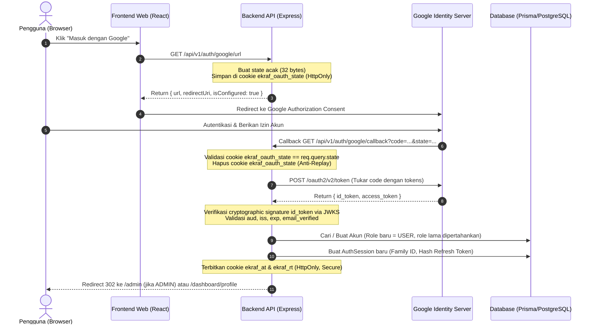

# EKRAF HUB — Keamanan Autentikasi & Sesi
**Dokumen Referensi:** `docs/security/AUTHENTICATION_SECURITY.md`  
**Status:** Terimplementasi & Teruji  
**Branch:** `fix/backend-foundation-security`

---

## 1. Ikhtisar Perbaikan Keamanan Autentikasi

Pada audit awal, ditemukan potensi celah Account Takeover (ATO) dan bypass verifikasi pada Google OAuth serta penggunaan hardcoded fallback JWT secret. Seluruh masalah tersebut telah diperbaiki secara menyeluruh pada branch ini.

---

## 2. JWT & Manajemen Rahasia (Secrets Management)

### 2.1 Eliminasi Fallback Secret
- Seluruh nilai default hardcoded (`ekraf_access_secret_super_secure_key_12345` dan sejenisnya) telah **dihapus**.
- Modul validasi environment (`apps/api/src/utils/env.ts`) memeriksa keberadaan `JWT_ACCESS_SECRET` dan `JWT_REFRESH_SECRET` saat startup.
- Persyaratan secret:
  1. Wajib memiliki panjang minimal 32 karakter (256-bit entropy).
  2. Dilarang menggunakan nilai contoh atau string default yang umum.
  3. Server akan langsung menghentikan proses (fail-fast) jika secret tidak memenuhi kualifikasi keamanan pada mode production.

### 2.2 Pinning Algoritma & Masa Berlaku Token
- Algoritma dibatasi secara eksplisit ke **`HS256`** baik pada penandatanganan (`jwt.sign`) maupun verifikasi (`jwt.verify`). Hal ini mencegah *Algorithm Confusion Attack* (misal: serangan `none` algorithm atau manipulasi kunci simetris vs asimetris).
- **Access Token:** Masa berlaku pendek (15 menit) disimpan dalam cookie HttpOnly `ekraf_at`.
- **Refresh Token:** Masa berlaku 7 hari disimpan dalam cookie HttpOnly `ekraf_rt` dengan path terbatas `/api/v1/auth`.

---

## 3. Google OAuth 2.0 Security (Authorization Code Flow)

### 3.1 Alur Kerja Resmi

### 3.2 Proteksi Terhadap Celah Keamanan OAuth
1. **Redirect URI Mismatch & Tampering:** Redirect URI diambil **hanya** dari environment variable `GOOGLE_REDIRECT_URI` di server. Query parameter `redirect_uri` dari client diabaikan sepenuhnya.
2. **Cryptographic State & Anti-Replay:** Nilai `state` digenerate menggunakan generator acak kriptografis (`crypto.randomBytes(32).toString('hex')`) dan disimpan dalam cookie `ekraf_oauth_state` (HttpOnly, Secure, TTL 5 menit). Cookie langsung dihapus begitu callback diproses untuk mencegah serangan penggunaan ulang (replay attack).
3. **Cryptographic ID Token Verification:** Menggunakan `google-auth-library` (`OAuth2Client.verifyIdToken`):
   - Signature token diverifikasi terhadap public keys resmi Google (JWKS).
   - `aud` wajib cocok dengan `GOOGLE_CLIENT_ID`.
   - `iss` wajib `accounts.google.com` atau `https://accounts.google.com`.
   - Token kedaluwarsa ditolak.
   - Klaim `email_verified` wajib bernilai `true`.
4. **Pencegahan Akun Palsu / Arbitrary Body Identity:** Endpoint `POST /google` **menolak** penerimaan raw `email` atau `displayName` tanpa adanya ID token Google yang lolos verifikasi kriptografis (AUTH-17).
5. **Role Preservation & Anti-Escalation:**
   - Akun baru yang mendaftar melalui Google selalu mendapatkan role `USER` (AUTH-14).
   - Pengguna lama yang login melalui Google mempertahankan role mereka sebelumnya (misal: ADMIN tetap ADMIN, tidak diturunkan atau dinaikkan tanpa otorisasi) (AUTH-15).
   - Akun yang berstatus nonaktif (`isActive: false`) langsung ditolak dan tidak diberikan sesi (AUTH-16).

---

## 4. Manajemen Sesi & Rotasi Token (Session Lifecycle)

### 4.1 Refresh Token Rotation & Reuse Detection
- Setiap kali token di-refresh pada `POST /api/v1/auth/refresh`:
  1. Hash token lama dicocokkan dengan database.
  2. Jika sesi lama tercatat telah dicabut (`revokedAt IS NOT NULL`) atau telah digantikan (`replacedBySessionId IS NOT NULL`), sistem mendeteksi terjadinya pencurian token (Token Reuse). Seluruh keluarga sesi (`familyId`) langsung dicabut secara permanen dan cookie dihapus.
  3. Dalam kondisi normal, sesi lama ditandai dicabut dan digantikan, lalu sesi baru diterbitkan secara atomik dalam satu transaksi database (`prisma.$transaction`).
- Penanganan Logout:
  - Endpoint `POST /api/v1/auth/logout` mencabut sesi di database dan menghapus kedua cookie (`ekraf_at` dan `ekraf_rt`).

---

## 5. Keamanan Cookie & CORS

- **CORS Allowlist:** Origin diverifikasi terhadap daftar eksplisit `envConfig.webOrigins`. Penggunaan wildcard `*` dilarang saat `credentials: true`.
- **Atribut Cookie:**
  - `httpOnly: true`: Mencegah akses cookie oleh JavaScript berbahaya (proteksi terhadap XSS session theft).
  - `secure: true`: Diwajibkan pada mode production HTTPS (`COOKIE_SECURE="true"`).
  - `sameSite: 'lax'`: Mencegah pengiriman cookie lintas situs pada permintaan POST pihak ketiga (proteksi CSRF).
